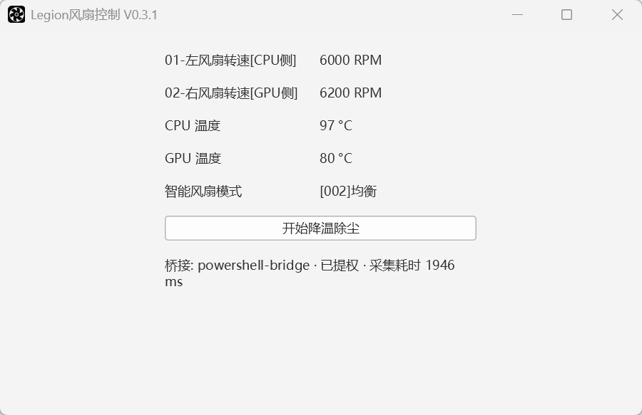

# 界面说明

> 返回 [项目主页](../README.md) · 相关文档：[技术原理](TechnicalPrinciples.md) · [已知限制与路线图](LimitationsAndRoadmap.md)

界面为**单列键值表 + 一个操作按钮**，底部一行状态栏。

> 更换截图时只需覆盖 `Docs/Asset/IMG/UI-Main.png`，**无需改动任何 Markdown**。

---

## 显示项

| 行 | 显示项 | 说明 |
|---|---|---|
| 1 | `01-左风扇转速[CPU侧]` | 单位 RPM；读数异常时显示 `读取失败` |
| 2 | `02-右风扇转速[GPU侧]` | 同上 |
| 3 | CPU 温度 | 单位 °C；无有效值时显示 `--` |
| 4 | GPU 温度 | 同上 |
| 5 | 智能风扇模式 | `[001]安静` / `[002]均衡` / `[003]性能` / `[255]自定义`；未知时显示 `未知` |
| 6 | 操作按钮 | 「开始降温除尘」↔「停止」 |
| 7 | 状态栏 | 桥接与采集耗时、倒计时、错误原因 |

---

## 操作按钮

| 状态 | 按钮文字 | 说明 |
|---|---|---|
| 未开启 | **开始降温除尘** | 下发烧速波形，进入 120 秒倒计时 |
| 已开启 | **停止** | 立即交还 EC 自动控制 |
| 切换进行中 | （短暂禁用） | 冻结期间不接受点击，避免与用户操作抢占；完成后按硬件实际状态恢复 |
| 未提权 | **需管理员权限** | 按钮禁用；正常情况下程序会自动申请提权，无需手动处理 |

**固件约 2 分钟后自动复位** —— 这是设计行为。程序会持续读回硬件真实状态并自动校正界面（例如倒计时尚未走完、但固件已交还 EC 控制时，按钮会自行回到「开始降温除尘」）。

---

## 状态栏

| 场景 | 显示内容（示例） |
|---|---|
| 正常运行 | `桥接: powershell-bridge · 已提权 · 采集耗时 2734 ms` |
| 降温除尘运行中 | `除尘波形运行中 · 剩余 96 s` |
| 手动停止 | `已手动停止，交还 EC 自动控制` |
| 固件自动复位 | `固件已自动复位，风扇交还 EC 自动控制` |
| 未提权 | `未以管理员运行：Lenovo WMI 会拒绝访问，转速与温度无法读取…` |
| 读取 / 切换异常 | `传感器读取异常: …` / `开启失败: …` / `复位失败: …` |

---

## 读数约定

- **`读取失败`** 表示该项取值异常（返回 `-1`）；而 **`0 RPM`** 是合法读数，二者被刻意区分。
- 状态栏显示的 `采集耗时` 是单轮实际耗时，可用于判断刷新性能。
- **标签中的方位（左 / CPU 侧、右 / GPU 侧）为推断结论**：依据是本机风扇表热特性 + 该机型配件市场的布局约定，**并非联想官方逐一标注，也未经拆机核实**。完整证据见[技术原理](TechnicalPrinciples.md#风扇方位标注的依据与置信度)。
